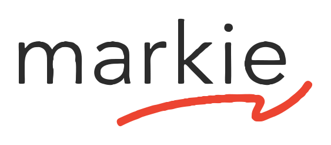

<h1>
  <picture>
    <source media="(prefers-color-scheme: dark)" srcset="docs/brand/markie-logo-reverse.svg">
    
  </picture>
</h1>

**Write, organize and share Markdown. Your files stay on your machine.**

[](https://markiedocs.com)

Markie is a desktop markdown app that gets out of your way: a clean editor with
live preview, a device-wide index of every markdown file you own, painless
sharing, and a built-in [MCP](https://modelcontextprotocol.io) server so any AI
agent (Claude Code, Codex, or a local model) can find, read, and write your
markdown right alongside you.

## Features

- **Editor + live preview**: edit, preview, or split view; GitHub-flavored
  markdown, tables, code highlighting, and KaTeX math.
- **Pictures, clips and video**: `` or `` beside the
  document just works; double-click a picture to see it full size, drag a corner to
  resize it, and a YouTube or Vimeo link on its own line becomes a playable card.
  The file stays plain markdown throughout.
- **Browse**: a device-wide index of every `.md` on your machine, so your notes and
  docs are one search away.
- **Agent & skill files**: surfaces `CLAUDE.md`, `AGENTS.md`, `GEMINI.md`,
  `~/.claude/skills`, `~/.codex`, and Cursor rules, grouped by tool.
- **Sharing**: share a doc via a public link or by email; recipients open it in
  one click, no account required.
- **Markie MCP**: let Claude Code / Codex work with your markdown (see below).

## Install

The current public downloads are **Apple Silicon macOS**, **Intel macOS**, and
**Windows x64**, signed through Azure Trusted Signing. All three update
themselves from their own signed feed. Linux x64 packaging is configured in the
source tree but nothing is published for it yet. Server download routes and
Electron Builder both read `server/download-manifest.json`, so storage, updater
feeds, and platform status cannot drift apart.

➡️ **[Download the latest Markie](https://markiedocs.com/download)**

Release integrations can read the current stable version and platform URLs from
[`/download/latest.json`](https://markiedocs.com/download/latest.json).

> Linux downloads are not published yet.

## The Markie MCP

Markie ships a dependency-free [MCP](https://modelcontextprotocol.io) server that
gives an AI agent a document workspace on *your* machine: markdown, plain text,
CSV, JSON, YAML, XML, Darkmown, Word, RTF, OpenDocument and HTML. Its tools are
`markie_find_documents`, `markie_search_documents` (the same full-text search as
the app's ⇧⌘F), `markie_read_document`, `markie_write_document`,
`markie_check_md`, `markie_list_skills`, `markie_guide`, and
`markie_open_in_markie`, plus the original markdown-only `markie_find_md`,
`markie_read_md` and `markie_write_md`. It runs locally and needs no API key.
Four optional tools (`markie_cloud_status`, `markie_cloud_sync`,
`markie_cloud_public_link`, `markie_cloud_revoke_public_link`) ask the running
Markie app to put a file in your Markie Cloud and return its link, with your
sign-in and your approval. Reads and writes are fenced to your home folder
(symlink-guarded), so an agent can *"find my notes and add a section"* and
actually do it. Writes are limited to text formats: Word, RTF, OpenDocument and
HTML come back to an agent as extracted, read-only text, and legacy `.doc` only
opens in the app.

Connecting also hands the agent Markie's organization conventions, so it says
where a document belongs as it writes:

```yaml
---
markie:
  project: bevrly
  block: checkout-redesign
---
```

New documents then arrive filed under that project and block in Markie, and
nothing moves on disk to make it happen. Claude Code users get the same
conventions as a plugin skill; every other MCP client receives them through the
server's `initialize` instructions.

It also teaches the agent to write rich documents: which format to pick
(markdown, or a Darkmown `.wd` when the reader should click, tick or calculate),
the elements Markie actually renders, how a picture, a clip or a recording is
written, where those files have to live to display at all, and which inline HTML
survives a save. `markie_guide` and the `markie://guide/markdown` resource serve
the whole of it, and `markie_check_md` reads a finished document back and names
anything in it that will not show up.

**Claude Code — plugin (easiest):**

```
/plugin marketplace add zvndev/markie
/plugin install markie@markie
```

**Codex or any other MCP client** — point it at the bundled server. The installed
app's **Agents** dialog shows the exact command; it looks like:

```toml
# ~/.codex/config.toml
[mcp_servers.markie]
command = "node"
args = ["/Applications/Markie.app/Contents/Resources/mcp/markie-mcp.mjs"]
```

(Running from source instead? Use `node /path/to/markie/mcp/markie-mcp.mjs`.)

## Build from source

Requires Node ≥ 22.

```bash
npm install
npm run electron:dev     # run the app in development
npm run electron:pack    # build an unsigned local macOS app
npm run electron:pack:mac:arm64
npm run electron:pack:mac:x64
npm run electron:pack:win
npm run electron:pack:linux
npm run electron:smoke:mac:arm64
npm run electron:smoke:mac:launch # macOS Apple Silicon host only
npm run electron:smoke:mac:x64
npm run electron:smoke:win
npm run electron:smoke:win:launch # Windows host only
npm run electron:smoke:linux
```

The local pack/build scripts use a certificate-free electron-builder wrapper and
pass `--publish never`. Signed releases go through the guarded release runner:
`release:prepare:mac` or `release:prepare:win`, then an early-access publish, then
`release:promote` to stable. [docs/RELEASING.md](./docs/RELEASING.md) is the full
runbook. The Windows unpacked package also installs the matching
Electron `better-sqlite3` Windows prebuild before `electron:smoke:win` runs.
Native macOS and Windows launch evidence includes `launch-smoke.json` plus a
captured `screenshot.png`. Windows launch evidence is handled by
`electron:smoke:win:launch` or the `Windows launch smoke` workflow on
`windows-latest`; it is not claimed from a Mac structure check.
After cross-architecture local packaging, the wrapper restores the development
`better-sqlite3` native module for your current Electron host. If Library or
Files ever get stuck after packaging, run `npm run native:restore`.

Other scripts: `npm run build` (typecheck plus the Vite bundle into `out/`),
`npm test` (renderer + Electron unit tests), `node --test mcp/lib.test.mjs`
(MCP tests), and `npm run release:preflight` (safe local release-readiness
checks, no publishing).

## Tech

Electron · Vite · React · TypeScript · Tailwind · TipTap · CodeMirror ·
a unified/remark/rehype render pipeline.

## License

[MIT](./LICENSE) © ZVN
